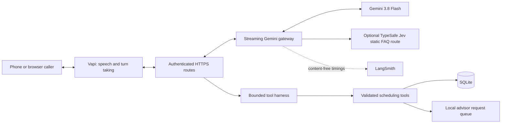

# ServiceVoice

A voice assistant for dealership service scheduling, built as an independent AI engineering interview project. The dealership, customers and reference evaluation cases are fictional. This project is not affiliated with BLiNK AI.

The problem is completing the caller's task accurately: find a valid appointment, capture corrections, read back the final details and save it only after confirmation. ServiceVoice separates conversational reasoning from the code that owns availability and appointment changes.

## Architecture



The v18 baseline uses Gemini `gemini-3.8-flash` with low reasoning, Soniox speech recognition and ElevenLabs speech synthesis through Vapi. This evaluation branch adds an isolated Gemini `gemini-3.8-flash-lite-tts` speech candidate, real sample-rate conversion, native closing and detailed call diagnostics. Phone acceptance remains separate from automated text/tool tests. Provider access and model availability depend on your account. Optional guarded narration from verified receipts and a narrow TypeSafe Jev FAQ route cannot confirm a booking or invent availability.

## What is implemented

- Availability, proposals, booking, appointment lookup, rescheduling and cancellation in a local scheduler.
- One intake appointment covering several supported services, with one reference and capacity block, complete readbacks and fresh confirmation after a service change. The intake block is not a repair-completion promise.
- Fresh, session-scoped proposals; readback and a later confirmation step before committing an appointment.
- Idempotent mutations, atomic capacity checks, issued-tool validation and verified result history.
- Bounded tool execution, pending/unknown operation states and recovery without blindly replaying uncertain work.
- Separate private operator console and authenticated public provider endpoints.
- Phone admission limits, an advisor request inbox and optional local MCP advisor integration.
- Content-free runtime tracing, synthetic reference datasets, native LangSmith experiments and hallucination checks.
- Automatic post-call reviews with separate mechanical booking checks, advisory semantic grades, evidence coverage, response-generation lineage and measured latency. See [component observability](docs/component-observability.md).
- Docker and single-instance Lightsail deployment packages, backup/restore tools and fault/load tests.
- An isolated [hybrid duplex browser experiment](docs/duplex-browser.md): continuous caller audio, cached Jev listening cues and locally coordinated interruption of the main reply.

An advisor request is a saved local task. It does not send a callback or transfer a live call. There is no real dealership CRM/DMS integration. Generated speech can still be wrong; these safeguards and evaluations reduce risk without guaranteeing zero hallucinations. The scheduler remains the authority for committed appointments.

## Run the local rehearsal

Use Python 3.12 and Node.js 22 or newer for frontend tests. No API key is needed for the scripted rehearsal.

On Windows PowerShell:

```powershell
py -3.12 -m venv .venv
.\.venv\Scripts\Activate.ps1
python -m pip install -r requirements-lock.txt
python scripts/install_sqlite_runtime.py
Copy-Item .env.example .env
python run.py
```

Open http://127.0.0.1:8765 and choose the scripted rehearsal. Keep the console private. The second listener, port 8766, exposes only authenticated voice-provider routes. `.env` uses `.local/` for this installation's database and tracing budget; neither is committed.

The Windows installer verifies a pinned SQLite archive and installs a project-private DLL plus a virtual-environment startup hook. It does not change system Python. Other operating systems need SQLite 3.51.3 or newer; the [Docker package](deploy/README.md) builds a pinned compatible runtime.

## Enable live voice

Add credentials to your ignored `.env`, following the [Vapi setup guide](integrations/vapi-setup.md). Live voice requires a Vapi account, accessible Gemini and speech-provider integrations, separate webhook/gateway secrets and a reachable HTTPS provider endpoint. TypeSafe and LangSmith are optional. Never put private keys in browser JavaScript or commit working credentials.

The [Lightsail guide](deploy/lightsail/README.md) describes a phone-first single-VM deployment. The default capacity profile admits at most four combined live calls. That limit must fit your Vapi/provider quotas; it is not evidence of four simultaneous phone calls meeting an audio latency target. A phone number is provisioned separately in Vapi or through a supported carrier integration.

## Test and evaluate

Install optional MCP test dependencies for the complete Python suite:

```powershell
python -m pip install -r requirements-mcp-lock.txt
npm ci --ignore-scripts
python -m evals.offline
```

The offline runner executes the Python suite and Node tests against disposable fixtures, checks source stability, and saves local logs and JUnit output under ignored `docs/evals/runs/`. It does not start paid model or phone calls.

GitHub Actions partitions every Python test file into four disjoint shards and runs all Node tests separately. Checkout preserves the exact source bytes used by fixed-hash audio fixtures. The caller stress runner records initial terminal-event responses and permits at most three attempts for identical, idempotent hang-up events after a busy/deadline response; it never retries booking tools through that helper or changes the production deadline.

The Linux-specific deployment package tests run in a separate GitHub Actions job. On Linux, run `python -m pytest -q deploy/test_server.py deploy/langsmith/test_templates.py deploy/lightsail/test_package.py integrations/telephony-lab/test_verify_pcap.py`.

[Evaluation instructions and v17/v18 results](docs/evaluations.md) cover reference datasets, paired experiments, judge calibration and the remaining known issue. Model executions, LangSmith uploads and synthetic voice calls are separate opt-in operations and can incur provider charges. Human microphone, interruption, multilingual listening and carrier checks remain necessary.

## Repository layout

| Path | Purpose |
|---|---|
| `app/` | API, domain model, scheduling tools, gateway, harness, observability and browser UI |
| `evals/` | Reference datasets, contract checks, model runs, judges and native LangSmith tooling |
| `tests/` | Offline Python and Node regressions |
| `scripts/` | Provisioning, benchmarks, backups and explicit live checks |
| `deploy/` | Docker, Lightsail and observability configuration templates |
| `integrations/` | Vapi setup, optional advisor MCP and isolated telephony lab |

This public repository contains a clean source snapshot. Credentials, customer/caller records, audio, private experiment URLs, deployment archives and local operational history are excluded. Third-party browser dependencies retain their own licenses in [THIRD_PARTY_NOTICES.md](THIRD_PARTY_NOTICES.md).

## Automatic live-call reviews

The optional post-call worker reviews completed calls automatically and sends
private scores and voice timing to its configured LangSmith project. The
original baseline uses `servicevoice-live-calls`; the isolated Gemini speech
candidate uses `servicevoice-speech-candidate`. It runs separately from voice generation and mounts the scheduler
volume read-only. The voice process receives no evaluation Vapi API key.

It checks factual grounding, action truthfulness, caller intent versus saved
booking details, confirmation order and explicit assent, literal reference
consistency, and available Vapi turn/stage latency. Deterministic checks cannot
prove human consent; semantic grades are advisory. Missing evidence is uncertain
with a null score, never a pass. Calls without measured response turns do not
receive zero-millisecond latency. No prompts, transcripts, customer details,
tool arguments, raw judge prose or provider signatures are exported to LangSmith.
The Gemini reviewer receives minimised text evidence; this redaction is not a
general DLP guarantee.

For Lightsail, copy `deploy/lightsail/evaluation.env.example` to a private,
owner-only `/etc/servicevoice/evaluation.env`, fill existing provider credentials,
and set the exact assistant UUID. The separate companion can reuse the locked
`servicevoice-app:lightsail` image already deployed:

```bash
docker compose -f deploy/lightsail/compose.evaluations.yaml build
docker compose -f deploy/lightsail/compose.evaluations.yaml up -d --no-build
```

This compose file assumes the existing `servicevoice-lightsail_application-data`
volume and `/data/servicevoice.sqlite3` database. Review those paths before using
it on another deployment or after a restore. It adds no public port and needs no
voice-server restart. Retain its separate evaluation-data volume: it holds the
durable queue, cached reviews, leases and model-attempt allowance. Restarting or
retrying an upload does not repeat an already cached model judgment.

For an explicit local worker, configure a private environment file with
`SERVICEVOICE_EVAL_SOURCE_DB`, `SERVICEVOICE_EVAL_OUTBOX`, the existing Vapi,
Gemini and LangSmith keys, workspace UUID and `VAPI_EVAL_ASSISTANT_ID`, then run:

```powershell
python -m app.live_evaluations --env-file PATH_TO_PRIVATE_ENV
```

Only the selected assistant and locally bound calls are eligible. Provider
reconciliation also catches calls ending before backend binding; these cannot
claim verified booking outcomes. Full call-list time windows are partitioned
rather than assuming API sort order. Unavailable provider records are excluded,
not counted as successes. Reviews normally follow hang-up by about one or two
minutes; provider outages and queued calls can take longer.

In LangSmith, inspect `voice.call.review` in the project matching the assistant
you tested. The original baseline's `live-call-review-v2` records are historical;
the evaluation branch's candidate reviewer uses `live-call-review-v5`. Check
each row's review version, source digest and judge prompt revision before
comparing results. `voice.review.coverage` records immutable worker-status
snapshots. Earlier versions remain visible; the historical v2 latency correction
reused frozen semantic grades without another model request. The separate
reference datasets/experiments remain regression evaluations, not real-call
performance denominators. See the [candidate reviewer guide](deploy/lightsail/speech-evaluations.md)
for its separate image, evidence volumes and outbox.

The default allowance is 200 post-call model attempts per UTC month per worker,
including failed attempts, and at most three attempts per call. Budget exhaustion
produces a visible uncertain semantic review. Feedback explicitly avoids
requesting extended trace retention; this is not a guarantee about account-wide
billing. These checks do not establish audio accuracy or zero hallucinations.
