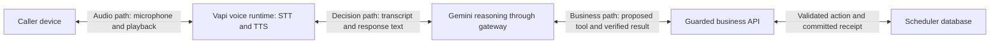

# Call evidence and component diagnostics

Every call needs two views: a trail through one conversation, and a blueprint
of the component at each step. They answer different questions.

The trail identifies the configuration, call, user turn, individual request and
business operation. The blueprint describes each component's input, output,
owner, possible failures and the evidence that can reveal them. The catalog in
`app/diagnostics.py` is the machine-readable reference for that blueprint.

The backend does not receive the caller's microphone stream or the device's
speaker playback. A successful text response or a successful TTS HTTP response
does not prove the caller heard the correct words.

## Names that connect the evidence

| Identifier | Meaning | Basis and limitations |
|---|---|---|
| Configuration ID | Immutable digest of owned application source and captured safe settings | Local requested configuration; the actual published provider assistant remains independently unverified until captured |
| Call key | SHA256 digest of the provider call ID | Joins the private sidecar records without storing the raw provider ID there; the scoped outer call review can retain its authorized provider link |
| Turn ID | Stable digest of call and user-message ordinal | Request-history ordinal, not an audio segmentation or proof that a transcript is correct |
| Request ID | One gateway, HTTP or synthesis attempt | Sibling requests can belong to the same turn; a new request is not automatically a new user turn |
| Operation ID | Existing session/tool-call idempotency identity | The same business operation keeps its identity on retry; diagnostics do not execute or retry it |
| Event ID | One immutable observed boundary or outcome | Identifies evidence; it is not itself a business receipt |

If a provider does not send a trustworthy call or turn ID, keep that linkage
unknown. Do not attach audio to the latest request merely because the timestamps
are close. An unbound HTTP request can be diagnosed without inventing a caller.

## What each component can show

| Component | Input and output | Owner | Failure examples | Observation |
|---|---|---|---|---|
| Caller device | Microphone sound → played sound | Device and carrier | Muted mic, packet loss, playback failure | Controlled endpoint capture; not available from the application backend |
| Voice runtime | Audio session → transport/events | Vapi and carrier | Connection failure, dropped call | Provider call status, end reason and timing |
| Speech recognition | Caller audio → transcript | Configured recognition provider | Misheard words/digits, missing speech | Provider transcript; accuracy requires independent audio comparison |
| Turn detection | Speech/silence → turn/interruption event | Vapi | Premature stop, missed interruption | Provider metrics and controlled speech tests |
| Gateway | Authenticated conversation → safe streaming request | ServiceVoice | Rejected auth, capacity limit, invalid history | Status, request timing and final outcome |
| Reasoning model | Prompt/history/tools → text or proposed tool | Google and ServiceVoice | Timeout, wrong tool, unsupported statement | Server timings, reported usage, semantic review |
| FAQ classifier | Eligible question → static label/fallback | TypeSafe and ServiceVoice | Timeout, unknown/incorrect route | Eligibility/fallback codes and timing |
| Receipt renderer | Verified receipt → approved readback | ServiceVoice | Stale receipt, mismatched result | Verification outcome and source/output hashes |
| Webhook | HTTP event → response or tool results | ServiceVoice/Vapi | Auth failure, deadline, invalid event | HTTP status and correlated event boundaries |
| Tool harness | Authorized request → pending/unknown/receipt | ServiceVoice | Overload, uncertain outcome, changed retry | Stable operation ID and receipt-present flag |
| Scheduler | Validated request → committed result | ServiceVoice demo database | Capacity conflict, lock, lost response after commit | Durable journal and state/receipt reconciliation |
| Speech synthesis | Approved text → generated audio | Google through Vapi custom TTS | Quota, timeout, invalid audio, pronunciation | Server byte boundaries and numeric timing; playback/pronunciation need audio review |
| Reviewer/exporter | Call evidence → grades and metrics | ServiceVoice/Gemini/LangSmith | Missing evidence, quota, delayed/failed upload | Queue health, review state, explicit uncertainty and readback |

These are diagnostic ownership boundaries, not automatic blame assignments. For
example, an inaccurate transcript can be caused by microphone quality, network,
recognition configuration or the speech model; the transcript alone cannot
identify the cause.

## Storage and safety boundaries

The explicit diagnostic initializer enables a bounded asynchronous sidecar by
default. `SERVICEVOICE_DIAGNOSTICS_ENABLED=off` disables it. Its normal path is
the scheduler filename with `-diagnostics.sqlite3` appended before the extension.
It never writes to scheduling tables. `record(...)` projects safe metadata and
enqueues it without disk or network I/O on the conversation path. A separate
thread writes batches, prunes retention and updates its heartbeat.

Default limits are 512 queued events, 20,000 retained events, seven days and a
64 MiB SQLite page cap. The writer refreshes its heartbeat while idle without
polling the database every audio chunk. Unknown free text, transcript text,
tool arguments, names, phone numbers, credentials, provider URLs and raw
exceptions are excluded. The private sidecar is revalidated before export;
writing a new key into its JSON does not make that key exportable.

The session-authorized local diagnostics endpoint and the post-call reader
must use the call bound to that session. Do not accept an arbitrary caller
query ID in a public diagnostic endpoint. The provider listener should expose
only required authenticated voice routes, not the operator console.

The automatic reviewer reads the business sidecar derived from its scheduler
path and, when configured at a distinct path, the additional speech sidecar in
`SERVICEVOICE_EVAL_DIAGNOSTICS_PATH`. That setting is additive: selecting the
speech ledger must not hide gateway, tool, scheduler or receipt observations.
Both sources are read-only and queried for the same exact call. An identical
configured path is read once.

The combined report retains each source's coverage and configuration identity.
A missing, malformed, truncated or stale source remains visible even when the
other source contains useful events. Different configurations are retained;
the reader does not relabel speech observations as business configuration or
invent turn/generation links. Identical events can be deduplicated, while
conflicting event identities cannot silently become trusted evidence.
In the call review, inspect `diagnostics.sources` for each source's state,
counts and configuration IDs. `diagnostics.configuration` describes only the
business runtime; `diagnostics.configurations` retains the observed source
configurations. `coverage_revision=call-diagnostic-sources-v1` identifies the
additive-reader contract. It does not imply every source had events for that call.

## Read coverage before judging success

`coverage.state=observed` means some valid application evidence was stored with
no known loss for that read. It does **not** mean every component was visible
or the conversation was correct. Overall `complete` remains false because
vendor internals and endpoint audio are not proven by server events.

The reader marks known queue/filter/storage loss, capacity/retention pruning,
truncated reads, malformed evidence, stale writers and prior unclean shutdowns.
Missing storage is `unavailable`, never a successful empty call. An unclean
process termination can lose queued events; that boundary is acknowledged
rather than presenting asynchronous logging as a lossless transaction log.
The durable business journal remains authoritative for saved appointments.
When multiple diagnostic ledgers are configured, inspect their source-level
coverage as well as the union. A useful partial union does not make a missing
source complete. An event count of zero also does not prove a component ran or
failed.

## Evaluate the complete appointment scope

A combined visit has one appointment ID, reference and 60-minute intake capacity
block. Ordered `appointment_services` child rows retain each requested catalog
service. Repair labor duration and completion time are not promised by that block.
Existing single-service databases and receipts remain readable.

The post-call reader uses read-only queries to compare every selected service
in the proposal, committed receipt and saved child rows. A clean primary service
does not hide a missing secondary request. Reschedules must also match the
approved target slot and preserve identity; cancellation must actually have a
cancelled status. These mechanical checks cannot prove that the caller heard
the readback or intended the chosen services. Transcript review and independent
listening cover those separate questions.

Service additions or removals require a fresh complete proposal, readback and
later explicit assent. Eligible standalone verified readbacks can use the
receipt renderer, including the full service list, without another model round.
An unanswered question or uncertain context still uses the reasoning model.

Judge reports include a prompt revision and SHA-256 digest. An authored control
comparison measures agreement with its authored targets, not production accuracy.
Disputed control labels, manual findings and missing audio remain visible;
historic automatic grades are not silently replaced.

A component with zero observed events is `unavailable`; it must not become
"successful" just because no failure was recorded. A component with a success
event means that boundary succeeded, not that every downstream effect did.
For instance, TTS bytes leaving this server establish neither delivery to the
caller nor audible pronunciation.

## Operator workflow

Open the call review, check its configuration and evidence coverage, then follow
the relevant turn/request/operation IDs. Inspect the component's recorded status
and timings. For a booking mismatch, compare the intended correction, issued
tool and committed receipt. For a suspected hearing or pronunciation failure,
use provider audio/transcript evidence when available and retain an unknown
verdict when no independent audio exists.

Use reviewed failures to create safe synthetic regression cases. Keep checks
that prevent unauthorized business actions in the live execution path;
post-call grading discovers problems after the conversation has already
occurred.

The data model follows the distinction between tracing identity and recorded
events described in [OpenTelemetry traces](https://opentelemetry.io/docs/concepts/signals/traces/).
No attempt is made to collect hidden model reasoning or claim that a trace
proves what the customer heard.

## Generation and interruption forensics

Each new gateway response attempt receives a persisted UUID `generation_id`.
Its process-local `generation_sequence` describes HTTP arrival order, not caller
turn order. Recorded lineage can identify a predecessor and its replacement,
the supersession time/cause, rejected ownership checkpoints, downstream HTTP
disconnect, first payload yield, final state and the exact emitted SSE response
ID. A supersession before release is different from one after output escaped.
An HTTP disconnect alone is not proof of an audible caller interruption.

The automatic v5 reviewer reads the call-scoped timing ledger and adds
`voice.gateway.generation` children under that call's `voice.call.review`.
Inspect each child's Outputs for these fields and its actual observed interval.
They are observations of existing model attempts, not additional paid model
generations. Older timing rows without the new stamp remain unavailable; the
reviewer does not retroactively manufacture generation identities.

The candidate supports a passive diagnostics overlay on its accepted application
initializer. It attaches the bounded sidecar to the gateway and harness, records
trusted HTTP/call/transcript boundaries and authoritative receipt observations,
and leaves the existing conversation controller and separate TTS service intact.
New tool observations obtain their turn ordinal from the existing authorization
read, with no additional database lookup before a booking. Missing diagnostic
metadata cannot reject an otherwise authorized tool. Configuration fingerprints
include the native hangup flag; effective provider configuration remains a
separate, independently unverified boundary.

Calls made before that overlay retain their original evidence coverage. Their
missing component-sidecar events are not backfilled or invented. The existing
timing-based generation children and separate call-bound TTS ledger remain
explicitly labelled evidence sources. An instantaneous breadcrumb without a
measured duration stays in the call report and is not fabricated as a timed
execution span.

Provider model-span IDs, local generation UUIDs and TTS request IDs are separate
identities. Custom TTS requests observed in the listening test carried a call ID
but no shared model-generation ID. Never join them using text, nearby timestamps
or matching counts. Clearing a queue or stopping a server response does not prove
that Vapi/carrier rejected an already-transmitted obsolete audio packet. That
end-to-end property needs a provider-supported identity and actual playback
evidence; this backend does not claim to verify it.

Provider cleanup can label a completed model request aborted. Keep
completed-then-cleanup separate from aborted-without-observed-output and from
confirmed audible barge-in. Likewise, provider pipeline cycles are not caller
utterances. Conflicting interruption flags retain their original scopes and an
unresolved interpretation instead of becoming fabricated interruption counts.

Separate forensic feedback may flag an automatic judge's blind spots without
rewriting its original verdict. Human listening reports, deterministic receipt
checks, provider termination and advisory text grades must remain distinguishable.

Provider tool history is reconciled against persisted scheduler attempts and
results in both directions. A clean saved appointment cannot prove that omitted
tool messages contained the right readback or confirmation sequence. Missing
chronology is uncertain evidence, rather than an invented booking failure or a
clean semantic pass. A model signature that was never executed does not itself
create a missing business operation.
